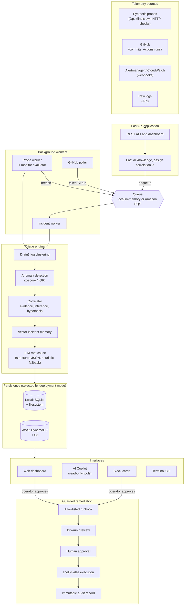
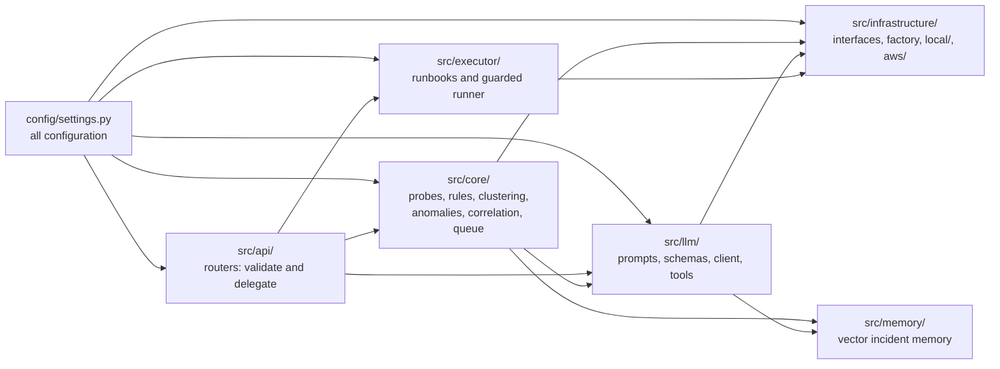
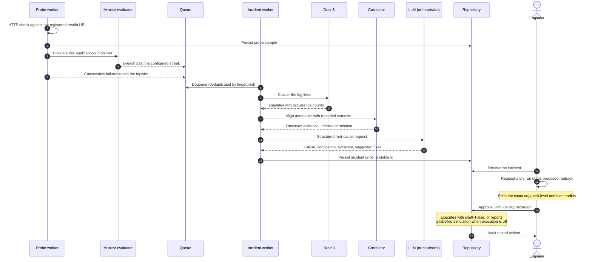
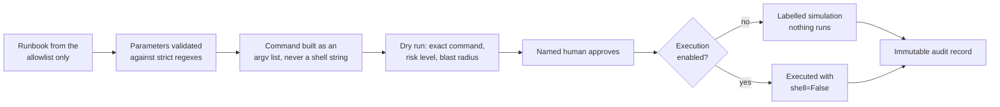

# OpsMind

An AIOps monitoring platform that detects incidents, explains them in plain language, and proposes
a fix that a human approves before anything runs.

OpsMind watches the endpoints you register, evaluates the alerting rules you configure, correlates
failures against the commits that preceded them, and asks a language model for a structured root
cause. It also watches your GitHub repository, so a failed CI run produces a suggested fix. Every
remediation is allowlisted, previewed as a dry run, and gated on explicit human approval.

It runs locally with no cloud account and no API key.

---

## Contents

- [The problem](#the-problem)
- [How OpsMind solves it](#how-opsmind-solves-it)
- [Architecture](#architecture)
- [Incident lifecycle](#incident-lifecycle)
- [User flow](#user-flow)
- [Quick start](#quick-start)
- [Configuring what to monitor](#configuring-what-to-monitor)
- [Connecting GitHub](#connecting-github)
- [The AI Copilot](#the-ai-copilot)
- [Safe remediation](#safe-remediation)
- [Tech stack](#tech-stack)
- [Configuration](#configuration)
- [API reference](#api-reference)
- [Security model](#security-model)
- [Deployment](#deployment)
- [Development](#development)
- [Project structure](#project-structure)
- [Limitations](#limitations)

---

## The problem

When a service degrades at three in the morning, the on-call engineer faces a specific sequence of
work, and almost all of it is manual.

| The question they have to answer | What it costs them today |
| :--- | :--- |
| Is something actually wrong? | Dashboards show hundreds of metrics and no verdict. Alerts fire on symptoms, not on impact. |
| What is broken, among thousands of log lines? | Grepping walls of near-identical text for the one line that matters. |
| What changed just before it broke? | Cross-referencing deployment history against a metric graph by eye. |
| Has this happened before? | Searching chat history and old postmortems, if anyone wrote them. |
| What do I do about it? | Recalling the right command under pressure, with production on the line. |
| Did my fix work? | Watching a dashboard and hoping. |

Each step is a context switch, and each one adds minutes to an outage. Existing tools solve pieces
of this: Prometheus records metrics, Grafana draws them, a log platform stores text. None of them
connect a metric spike to a commit to a past incident to a specific remedy.

## How OpsMind solves it

OpsMind is deliberately not another metrics store or log viewer. It is the layer that joins the
evidence together and carries a failure through to a verified fix.

| Problem | What OpsMind does |
| :--- | :--- |
| Alert noise buries the signal | Drain3 collapses repetitive log lines into a handful of templates, cutting the volume sent to the model by an order of magnitude |
| No verdict, only graphs | Produces one plain-English root cause with a calibrated confidence score and the evidence behind it |
| "What changed?" takes twenty minutes | Correlates anomaly onset against recorded commits in a time window and names the commit and author |
| Monitoring needs a separate stack | Probes the health URLs you register itself, so useful monitoring works with nothing else installed |
| CI failures are triaged by hand | Detects a failed GitHub Actions run, reads the failing job's log, and suggests the change that fixes it |
| Institutional memory is lost | Indexes resolved incidents as vectors and retrieves the closest past failure |
| Remediation is risky or forbidden | Allowlist-only runbooks, built as argument vectors with no shell, previewed as a dry run, and executed only after a named human approves |
| Postmortems never get written | Generates a blameless Markdown report from the incident record |

A deliberate scope boundary: OpsMind does not try to replace Prometheus alerting. Its rules cover
the signals it measures itself. There is no expression language, no label matchers, and no
notification routing. See [Limitations](#limitations).

---

## Architecture

OpsMind runs in two modes behind one set of interfaces. Local mode is the default and needs no
cloud account; AWS mode swaps the implementations without touching any business logic.



### Layers and their dependency direction

Dependencies point one way only, which is what keeps both deployment modes viable.



Routers stay thin so a worker and the CLI can call exactly the same function as an HTTP request.
Nothing outside `src/infrastructure/` imports `boto3` or `sqlite3`.

---

## Incident lifecycle



---

## User flow

```mermaid
flowchart LR
    A["Register an application<br/>name + health URL"] --> B["OpsMind probes it<br/>on your interval"]
    B --> C["Add monitors<br/>choose what matters"]
    C --> D["Connect GitHub<br/>repo + access token"]
    D --> E["Something breaks"]
    E --> F["Incident appears with a<br/>plain-English cause"]
    F --> G["Ask the Copilot<br/>for detail"]
    G --> H["Preview the safe fix<br/>dry run"]
    H --> I["Approve it<br/>identity recorded"]
    I --> J["Audit record<br/>+ postmortem"]
```



The dashboard has two modes. **Beginner** shows plain language only: no JSON, no regular
expressions, no cluster identifiers. **Engineer** reveals the raw payloads, exact commands,
cluster templates and similarity scores, without changing the layout.

---

## Quick start

Requirements: Python 3.11 or newer. Node 20 is only needed if you change frontend source, because
the built bundle is committed.

```bash
git clone https://github.com/sasindu345/opsmind.git
cd opsmind

python3 -m venv .venv
.venv/bin/pip install -r requirements.txt

cp .env.example .env     # optional: works with defaults
.venv/bin/python -m uvicorn src.main:app --reload --port 8000
```

Open `http://localhost:8000`.

Nothing else is required. With no API key configured, OpsMind runs open and falls back to
deterministic heuristic analysis instead of a language model. To enable AI analysis, add a free
Gemini key to `.env`:

```ini
LLM_PROVIDER="gemini"
GEMINI_API_KEY="your-key"
```

Verify it end to end:

```bash
# Register something to watch
curl -X POST http://localhost:8000/api/v1/applications \
  -H 'Content-Type: application/json' \
  -d '{"app_id":"demo","name":"Demo API","health_url":"https://example.com/"}'

# Probe it now instead of waiting for the interval
curl -X POST http://localhost:8000/api/v1/applications/demo/probe

# Confirm the SSRF guard rejects an internal target
curl -X POST http://localhost:8000/api/v1/applications \
  -H 'Content-Type: application/json' \
  -d '{"app_id":"blocked","name":"Blocked","health_url":"http://169.254.169.254/"}'
curl -X POST http://localhost:8000/api/v1/applications/blocked/probe
```

---

## Configuring what to monitor

A monitor is one condition over one signal that OpsMind already measures. Create them in the
dashboard on an application's detail page, or over the API.

| Signal | Meaning |
| :--- | :--- |
| `probe_latency` | Response time in milliseconds, compared on the latest sample |
| `probe_error_rate` | Percentage of failed checks across the window |
| `probe_availability` | Percentage of successful checks across the window |

Each monitor chooses a detection mode:

- **Threshold** compares against a limit you set, using `gt`, `gte`, `lt` or `lte`.
- **Anomaly** compares against the signal's own recent behaviour using z-score or IQR, which is
  useful when you do not know the right number in advance.

A monitor only raises an incident after its condition holds for `consecutive_breaches_required`
checks in a row, and the counter resets on recovery. This is what stops a single slow response
from paging anyone.

```bash
curl -X POST http://localhost:8000/api/v1/applications/demo/monitors \
  -H 'Content-Type: application/json' \
  -d '{
    "name": "Slow checkout responses",
    "signal_source": "probe_latency",
    "mode": "threshold",
    "comparison": "gt",
    "threshold_value": 800,
    "consecutive_breaches_required": 3,
    "severity": "HIGH"
  }'
```

A breach flows through the same triage pipeline as any other incident, so it arrives with a root
cause and a suggested fix rather than only the threshold arithmetic.

---

## Connecting GitHub

OpsMind polls the GitHub API rather than requiring webhooks, so it works from a laptop with no
public URL or tunnel. A webhook receiver is also available for real-time setups, and the two paths
deduplicate against each other.

Connect a repository on the Repositories page, or over the API:

```bash
curl -X POST http://localhost:8000/api/v1/repositories \
  -H 'Content-Type: application/json' \
  -d '{
    "app_id": "demo",
    "owner": "your-org",
    "name": "your-repo",
    "access_token": "ghp_your_token"
  }'
```

The token needs read access to code and Actions. It is verified before anything is stored, written
through the secret manager, and never returned by any endpoint or written to a log: the API reports
only `token_configured: true`.

Once connected, OpsMind:

- records each new commit as deployment telemetry, so the correlator can say which commit preceded
  an incident;
- detects workflow runs that concluded in failure, reads the failing job's log tail, and raises an
  incident analysed with a build-engineer prompt rather than the SRE one, because a CI failure is
  fixed in the repository and not by restarting production.

Polling uses conditional requests, so a cycle with no new activity costs no API quota, and it stops
polling a repository that falls below a configurable remaining-quota floor.

---

## The AI Copilot

Ask a question in plain language and get an answer grounded in your own telemetry.

The Copilot works by calling read-only tools and citing what they return: application health, probe
history, aggregated metrics, incidents, clustered log patterns, recorded commits, and the vector
incident memory. Each answer shows which tools ran, so you can check the reasoning instead of
trusting it.

**The Copilot cannot change anything.** There is no execution tool in its catalog. It can name a
runbook for you to review, which deep-links to the dry-run preview, leaving the human approval gate
exactly where it is. A test asserts the tool catalog never imports the executor.

With no language model configured, the Copilot still answers: it falls back to a deterministic
summary built from the same tools and labels itself as a data summary rather than an analysis.

---

## Safe remediation

Remediation is the part most likely to cause harm, so it is the most constrained.



The catalog ships five runbooks: roll back a deployment, restart a service, scale a workload, clear
a cache, and cordon a node. Anything not in the catalog is refused.

Real execution is off by default (`REMEDIATION_EXECUTION_ENABLED=false`). An approval then produces
a clearly labelled simulation, and both the API response and the audit record say so, so a
simulated success can never be mistaken for a real one.

---

## Tech stack

| Layer | Choice | Why |
| :--- | :--- | :--- |
| API | FastAPI, Pydantic v2, Uvicorn | Async, typed request and response models, OpenAPI for free |
| Configuration | pydantic-settings | One typed source of configuration with validated ranges |
| Log intelligence | Drain3 | Collapses repetitive logs into templates without training |
| Statistics | NumPy | Z-score and IQR anomaly detection |
| LLM access | LiteLLM | One interface across Gemini, Ollama and Bedrock |
| Incident memory | SQLite plus a TF-IDF vector index | Semantic retrieval with no external vector database |
| Frontend | React 19, esbuild | Single committed bundle, so the app runs without Node installed |
| Charts | Hand-written SVG | Latency sparklines and uptime bars with no charting dependency |
| ChatOps and CLI | Slack Bolt, Typer, Rich | Interactive cards and a usable terminal interface |
| Reporting | Jinja2 | Markdown postmortems |
| Local persistence | SQLite, local filesystem | Zero setup |
| Cloud persistence | DynamoDB, S3, SQS, EventBridge, Secrets Manager | Managed and pay-per-request |
| Cloud LLM | Amazon Bedrock | Private inference inside the account |
| Infrastructure | Terraform | Reproducible, reviewable provisioning |
| CI/CD | GitHub Actions | Lint, tests on three Python versions, Terraform validation, Docker build, bundle freshness, deploy |

---

## Configuration

Every value resolves from `config/settings.py`, overridable by environment variable or `.env`.
There are no hardcoded URLs, intervals, thresholds, model names or limits in the code.
`.env.example` documents all 50 settings; the ones you are most likely to touch:

| Variable | Default | Purpose |
| :--- | :--- | :--- |
| `DEPLOYMENT_MODE` | `local` | `local` or `aws`. Selects every provider implementation |
| `API_KEY` | empty | When set, mutating endpoints require `X-API-Key`. Empty means open |
| `LLM_PROVIDER` | `gemini` | `gemini`, `ollama` or `bedrock` |
| `GEMINI_API_KEY` | empty | Without it, analysis falls back to heuristics |
| `SYNTHETIC_PROBES_ENABLED` | `true` | Run the background health-probe worker |
| `SYNTHETIC_PROBE_TRIPWIRE` | `3` | Consecutive failures before an outage incident opens |
| `GITHUB_POLLING_ENABLED` | `true` | Run the repository poller |
| `GITHUB_POLL_INTERVAL_SECONDS` | `300` | How often a repository is checked |
| `MONITOR_ZSCORE_THRESHOLD` | `3.0` | Sensitivity of anomaly-mode monitors |
| `REMEDIATION_EXECUTION_ENABLED` | `false` | Off means an approval is simulated and labelled |
| `DASHBOARD_BASE_URL` | `http://localhost:8000` | Used in links sent to Slack |

---

## API reference

Interactive documentation is at `/docs`. The API covers these groups:

| Group | Endpoints |
| :--- | :--- |
| System | `GET /healthz`, `GET /readyz`, `GET /api/v1/session` |
| Applications | `GET POST /api/v1/applications`, `GET PATCH DELETE /api/v1/applications/{id}`, `POST /api/v1/applications/{id}/probe` |
| Monitors | `GET POST /api/v1/applications/{id}/monitors`, `GET PATCH DELETE .../monitors/{monitor_id}`, `POST .../evaluate`, `GET /api/v1/monitors/options` |
| Metrics | `GET /api/v1/applications/{id}/metrics` |
| Repositories | `GET POST /api/v1/repositories`, `GET PATCH DELETE /api/v1/repositories/{id}`, `POST .../test-connection`, `POST .../poll` |
| Incidents | `GET /api/v1/incidents`, `GET /api/v1/incidents/{id}`, `POST .../acknowledge`, `POST .../resolve`, `GET .../timeline`, `POST .../postmortem`, `GET .../similar` |
| Remediation | `POST /api/v1/incidents/{id}/remediation/dry-run`, `POST .../approve`, `GET /api/v1/remediations/runbooks`, `GET /api/v1/remediations/audit` |
| Copilot | `POST /api/v1/copilot/chat`, `GET /api/v1/copilot/suggestions` |
| Analysis | `POST /api/v1/analyze/logs`, `POST /api/v1/analyze/logs/async` |
| Webhooks | `POST /api/v1/webhooks/prometheus`, `POST /api/v1/webhooks/github`, `POST /api/v1/webhooks/cloudwatch` |

---

## Security model

**Server-side request forgery.** Any user-supplied URL, including health URLs and the configurable
GitHub API base URL, passes through `SSRFValidator`. It permits only HTTP and HTTPS, resolves DNS
ahead of the request, rejects loopback, RFC 1918 private ranges, link-local addresses and cloud
metadata endpoints, pins the socket to the validated address so a rebinding response cannot
redirect the check, re-validates every redirect, and caps redirects, timeout and body size.

**Command execution.** Runbook commands are built as argument vectors and executed with
`shell=False`, so there is no shell to inject into. Every parameter is validated against a strict
regular expression. Anything outside the allowlist is refused.

**Human approval.** Mutating operations require an explicit approval carrying an operator identity,
which is recorded. AI components are structurally barred from executing anything: the Copilot's
tool catalog contains no execution tool.

**Secrets.** Credentials are never literals, never logged, and never returned by an API. A GitHub
token is stored through `SecretManager`, which writes an owner-only file locally or AWS Secrets
Manager in cloud mode. Records hold a reference, not the value.

**Authentication.** When `API_KEY` is set, mutating endpoints require a matching `X-API-Key`,
compared in constant time. Reads, health probes and the dashboard stay open so the status page
works without credentials. Webhooks are exempt and verified by HMAC instead, because GitHub cannot
send a custom header.

**Audit trail.** Every approved remediation appends an immutable record: who approved it, why, the
exact argument vector, the exit code, the output, and whether it really executed or was simulated.

---

## Deployment

### Docker

```bash
docker compose up --build
```

Starts the API and the worker. Prometheus and Ollama are available as optional profiles.

### AWS

Terraform in `infra/terraform/` provisions a single low-cost EC2 host, SQS with a dead-letter queue,
a DynamoDB table billed per request, an encrypted S3 bucket with lifecycle expiry, an EventBridge
bus, CloudWatch log groups and alarms, and a least-privilege IAM role. There is no NAT gateway.

```bash
cd infra/terraform
cp terraform.tfvars.example terraform.tfvars
# ssh_allowed_cidr_blocks has no default and must be set to your own address
terraform init && terraform apply
```

SSH ingress is scoped separately from the application port and rejects `0.0.0.0/0`, so a publicly
reachable dashboard never implies a publicly reachable shell. Prefer SSM Session Manager, which the
IAM role already supports and which needs no inbound SSH at all.

Continuous deployment runs on a push to `main` once the repository variables
`OPSMIND_S3_BUCKET`, `OPSMIND_EC2_INSTANCE_ID`, `OPSMIND_DEPLOY_HOST`, `OPSMIND_APP_PORT` and
`AWS_REGION` are set, with AWS credentials in secrets. No environment identifier is committed to
this repository, and the job fails loudly if one is missing.

---

## Development

```bash
.venv/bin/python -m pytest -v          # 177 tests
.venv/bin/python -m ruff check .
.venv/bin/python -m ruff format --check .
npm install && npm run build           # only for frontend changes
```

`static/app.js` is a committed build artifact so the application runs without Node. CI rebuilds it
and fails if the committed bundle is stale, so run `npm run build` in the same change that edits
frontend source.

See [CLAUDE.md](CLAUDE.md) for the conventions this codebase is held to, and
[ROADMAP.md](ROADMAP.md) for what is built and what is not.

---

## Project structure

```text
opsmind/
├── config/settings.py              All configuration, typed and validated
├── src/
│   ├── main.py                     FastAPI app, background worker lifecycle
│   ├── api/                        Routers, request models, auth dependency
│   ├── core/
│   │   ├── security.py             SSRF validator
│   │   ├── synthetic.py            Probe worker and failure tripwire
│   │   ├── monitor_evaluator.py    User-configured rule evaluation
│   │   ├── github_client.py        GitHub REST client
│   │   ├── github_poller.py        Commit and CI-failure polling
│   │   ├── drain_filter.py         Log clustering
│   │   ├── anomaly_detector.py     Z-score and IQR detection
│   │   ├── correlator.py           Evidence, inference and hypothesis
│   │   ├── telemetry.py            Unified signal store
│   │   ├── pipeline.py             End-to-end triage orchestration
│   │   └── worker.py               Queue and incident worker
│   ├── llm/                        Prompts, schemas, client, copilot, tools
│   ├── executor/                   Runbook allowlist and guarded runner
│   ├── memory/                     Vector incident memory
│   ├── infrastructure/             Interfaces, factory, local/ and aws/
│   ├── chatops/                    Slack cards and handlers
│   ├── cli/                        Typer terminal interface
│   └── frontend/                   React source, bundled to static/app.js
├── static/                         index.html, style.css, committed app.js
├── templates/                      Postmortem template
├── tests/                          27 test modules
├── infra/terraform/                Infrastructure as code
└── docs/                           Deployment, security and operations guides
```

---

## Limitations

Stated plainly, because a monitoring tool that overstates itself is worse than one that does less.

- **Monitors cover OpsMind's own probe signals.** There is no expression language, no multi-condition
  rules, no label matchers, no alert silencing and no notification routing. For those, use
  Prometheus; OpsMind is the layer that explains failures, not the one that stores every metric.
- **Prometheus and CloudWatch are ingestion-only.** Their webhooks are received, but OpsMind does
  not query them. `PROMETHEUS_URL` is reserved for that and is not yet read.
- **Post-remediation verification is not automated.** An approved fix is executed and audited, but
  OpsMind does not yet re-probe on a schedule and close the incident itself.
- **Copilot conversations are not persisted.** History lives in memory, bounded by turns and a TTL,
  and is lost on restart. Answers are regenerated from live evidence.
- **Local mode is single-process.** The in-memory queue is not shared between processes, so running
  the API and the worker separately needs AWS mode with SQS.
- **The frontend has no automated test suite.** Backend coverage is 177 tests; the dashboard is
  verified by hand.
- **Real remediation is off by default.** Until `REMEDIATION_EXECUTION_ENABLED=true`, an approval is
  a labelled simulation. This is deliberate, but it means the default configuration cannot fix
  anything by itself.

---

## License

MIT. See [LICENSE](LICENSE).
